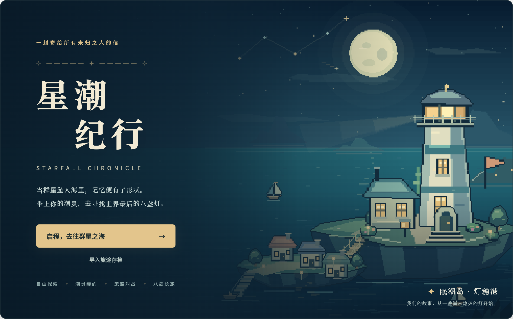
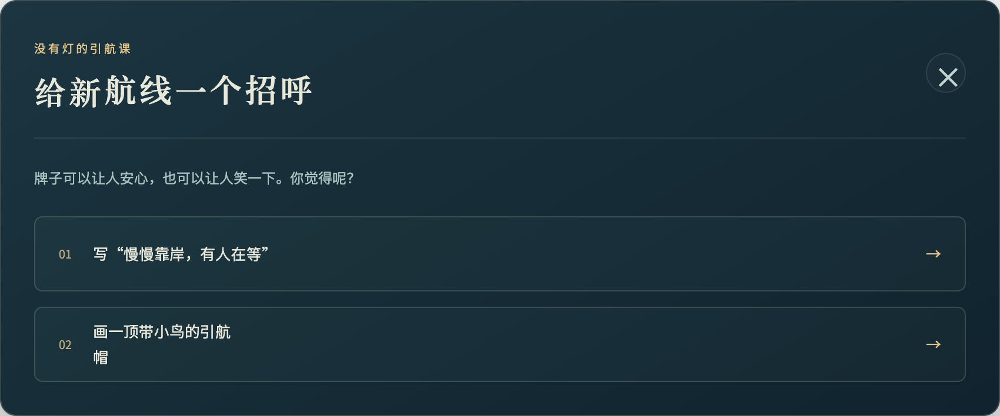
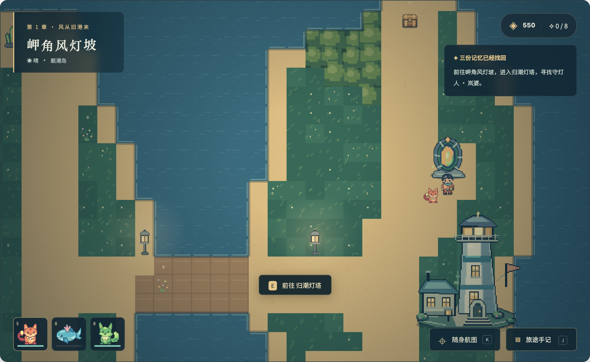
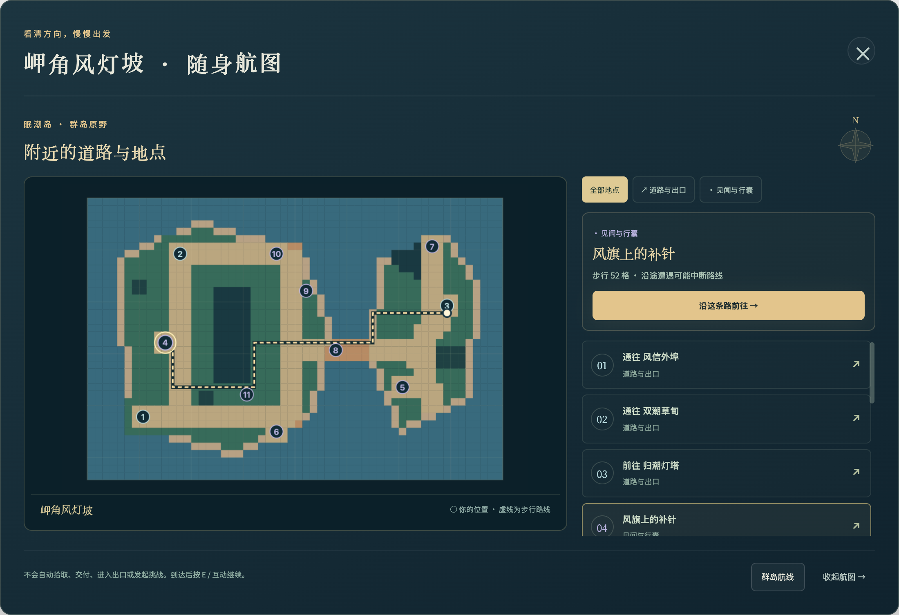
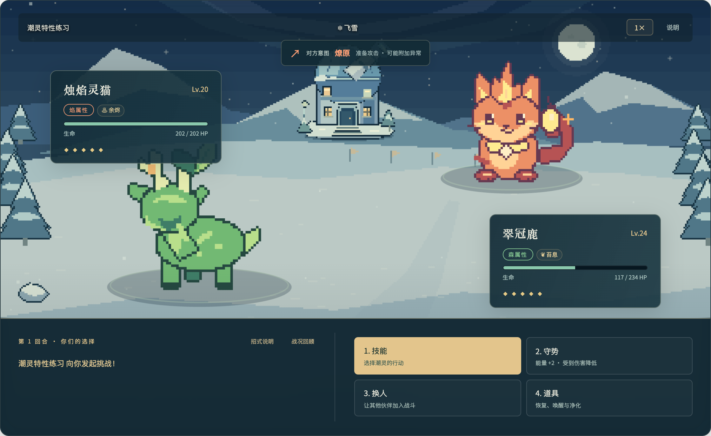
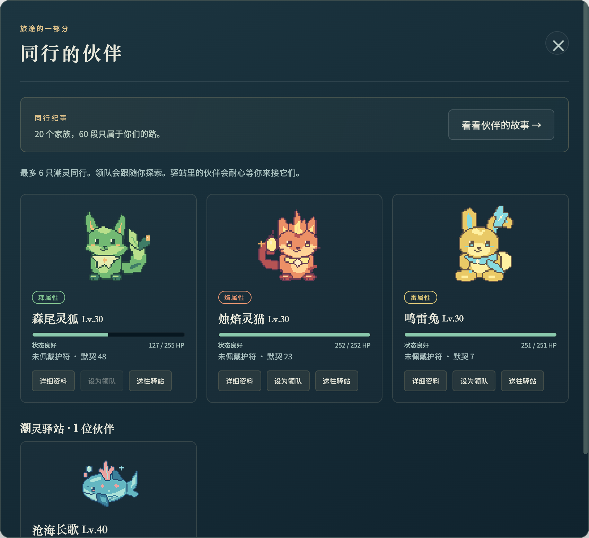
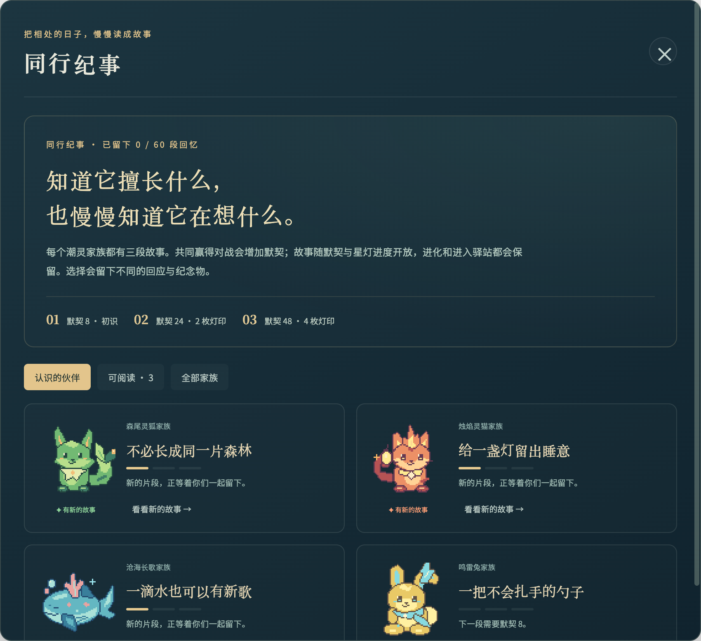
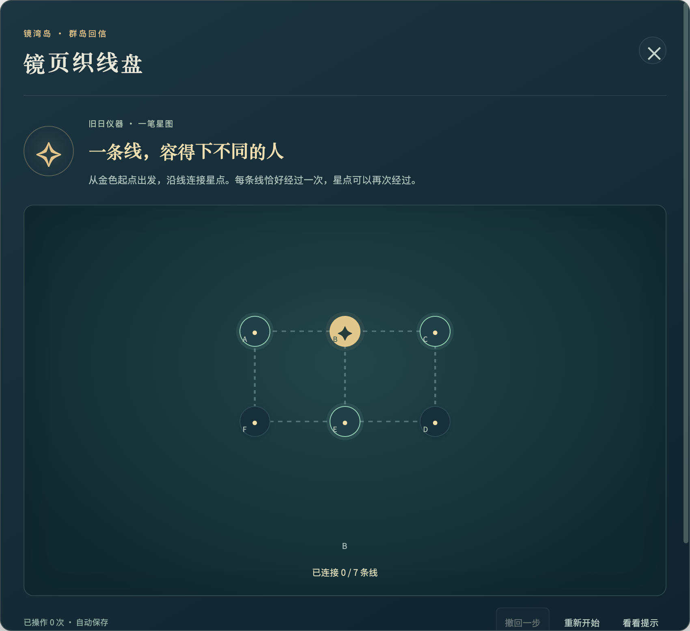
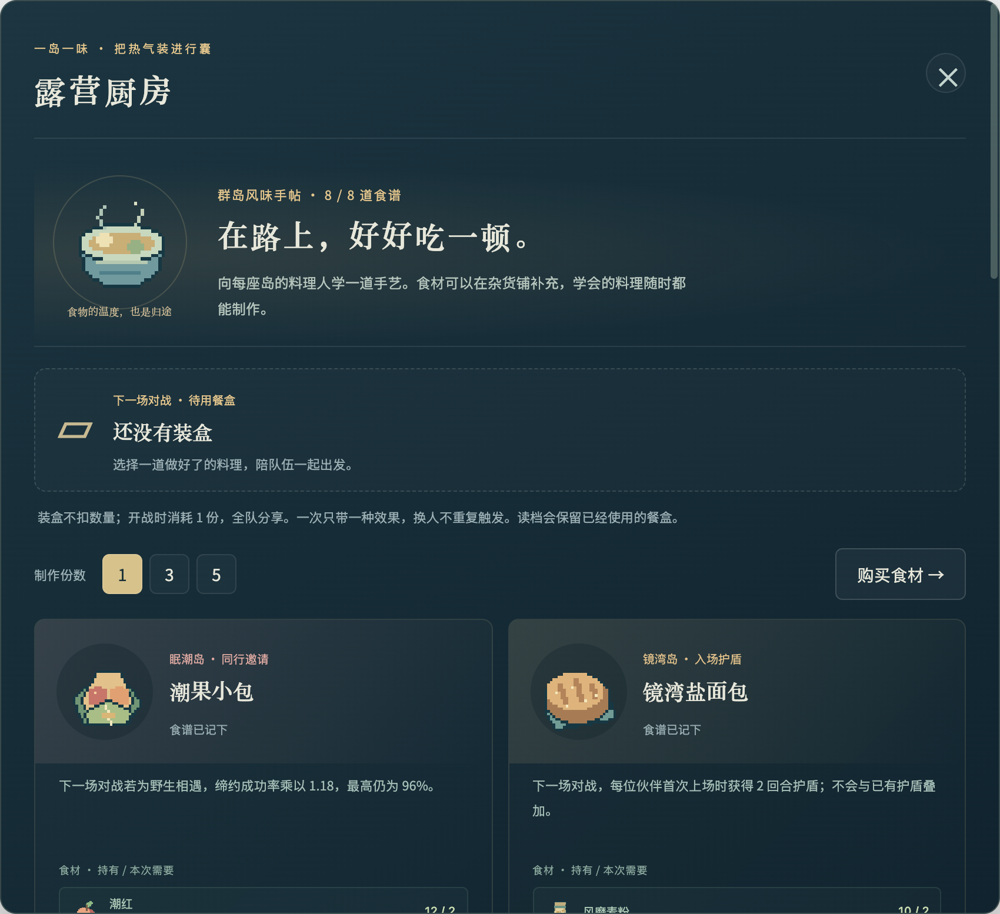
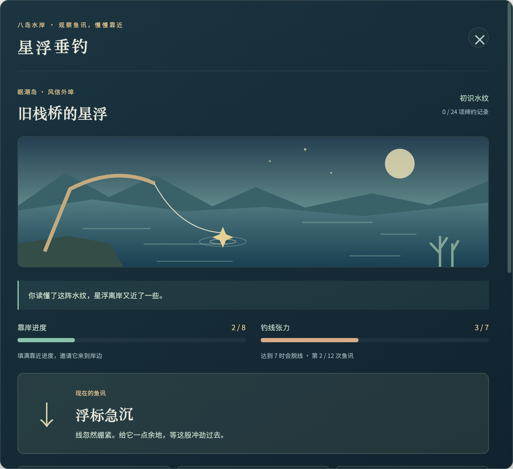

# 星潮纪行 · Starfall Chronicle

**把昨天交还给海，把明天留给自己。**

一款原创 2D 群岛探索与潮灵收集 RPG。带上伙伴，穿过八座被星潮改变的岛屿，修复记忆里的灯，在回合制对战中寻找一起走下去的办法。

**[▶ 免登录游玩](https://starfall-chronicle.seedagi.chatgpt.site)** · **[📖 完整攻略](docs/WALKTHROUGH.md)** · [运行方法](#本机运行) · [验证记录](docs/VALIDATION.md)

[](docs/images/title.png)

*点击图片可查看无损 PNG 原图。10 张配图以 2× 分辨率导出，宽度为 1700–2240 像素。画面均来自游戏实际界面，使用独立演示进度展示；菜单图为可视区域的局部导出。[图片与导出说明](docs/images/README.md)*

当前版本 **0.16.0**。桌面键鼠和手机触屏均可操作，进度自动保存在浏览器中。公开链接可直接开始，不需要注册账号。

## 游戏内容

| 玩法 | 当前内容 |
| --- | --- |
| 群岛主线 | 8 章剧情与结局、8 座城镇、24 个户外分区、32 层遗迹，共 64 张地图 |
| 地区冒险 | 24 条寻找记忆的任务路线、144 个阶段，包含交谈、调查、对战、交付和解谜 |
| 潮灵养成 | 20 个原创家族、60 种成长形态、9 种属性、38 个技能，六人队伍与备用驿站 |
| 策略对战 | 敌方行动预告、轮换、能量、天气、异常、家族特性、四招搭配与护符 |
| 人物故事 | 24 个居民委托、24 段居民故事、60 章伙伴同行纪事、营火谈话 |
| 探索与解谜 | 随身航图和真实寻路、24 组符柱封门、8 台旧日仪器与群岛回信 |
| 旅途生活 | 8 道料理、8 位厨师、4 个生态调查、8 处水岸与 24 项当地缔约记录 |
| 通关之后 | 8 段人物邀请、24 阶星海试航及共同尾声，随后可继续远海切磋 |
| 续玩体验 | 自动存档、上一份备份、导入导出、完整回合恢复、章节与已选回应回看 |

像素角色与场景由项目代码绘制，音乐与音效由浏览器合成。提供精细、均衡、流畅三档画质及实时 FPS 显示。

## 阅读导航

[故事与角色](#故事与角色) · [探索与航图](#探索与航图) · [策略对战](#策略对战) · [潮灵与同行故事](#潮灵与同行故事) · [遗迹解谜](#遗迹解谜) · [料理与垂钓](#料理与垂钓) · [本机运行](#本机运行) · [新手攻略](#新手攻略第一座岛怎么过) · [常见问题](#常见问题)

## 故事与角色

星潮落下的那一夜，港口有十七个人忘记了同一个名字。你在旧船坞醒来，手里只有一枚坏掉的罗盘，背面写着：“若你忘记了归途，就去寻找八盏灯。”

阿汐与你同行，洛珈博士为你介绍潮灵与星潮。八座岛屿各自困在一种记忆的异变中：熄灭的灯塔、照出陌生面孔的镜子、重复着最后一句话的旧信……修复星灯的路上，你会慢慢找回这枚罗盘与自己的来处。

| 初识的人 | 在旅途中的位置 |
| --- | --- |
| **旅人 · 你** | 从失去记忆开始，用今天的行动重新认识自己 |
| **阿汐** | 在旧船坞找到你的旅伴，陪你经过八座岛，也有自己的疑问 |
| **洛珈博士** | 研究星潮与潮灵，指引你开始帮助灯穗港的居民 |
| **浮葵** | 第一条地区冒险的引航员，与你重新练习把人带回岸边 |
| **岚婆** | 守了灯塔四十二年的守灯人；她关心你与潮灵为何愿意同行 |
| **白露** | 镜湾岛的档案师，保管着倒影、名字与尚待核实的往事 |

### 每一份记忆，都来自一段相处

地区冒险包含交谈、实地调查、战斗、素材交付和机关。居民故事还有可以选择的回应，例如为一位回乡的熟客更新菜单，或与家人一起做一道从未尝过的汤。已经作出的选择可以在旅途往事中回看。

[](docs/images/story.png)

*剧情界面：读完对话后作出回应。完整攻略按任务阶段列出目标，重要解谜答案放在折叠区。*

## 探索与航图

从灯穗港的海风出发，穿过湿地、炉火山道、悬空栈道、雪原与深林。每座岛都有城镇、三个户外分区和四层遗迹，沿路能遇到当地居民、野生潮灵、训练师、材料和见闻。

[](docs/images/exploration.png)

*探索画面：左上显示当前位置，右上显示当前任务，领队会跟随你行走。靠近入口后按 E 互动。*

### 找不到下一站时，先打开随身航图

按 **K** 查看当前地图，在地点列表中选目标，即可看到真实道路上的步行路线和距离。选“沿这条路前往”后会自动步行，沿途遭遇可能打断路线；到达后按 E 完成交谈、拾取或进入出口。

[](docs/images/navigation.png)

一段常见的游玩流程是：**在手记中选任务 → 用航图找下一站 → 调查或对战 → 回城恢复与整备 → 收齐三份记忆 → 探索遗迹 → 挑战守灯人 → 乘船前往下一岛。** 料理、生态调查与垂钓可以穿插在路上。

## 策略对战

对战使用回合制。每一回合都要考虑当前属性、能量、生命、异常状态，以及对方已经露出的行动意图。

[](docs/images/battle.png)

*对战画面：可以先读意图，再决定攻击、守势、轮换或使用道具。图中为独立的潮灵特性练习场景。*

| 你可以考虑的事 | 实际用法 |
| --- | --- |
| **对方要做什么** | 观察攻击、恢复、守势或换人的预告；意图提供决策线索 |
| **能量够不够** | 守势回复 2 点能量并减伤，用低耗招式衔接高耗招式 |
| **属性是否合适** | 9 种属性有各自的克制关系，轮换能让不同伙伴分担战局 |
| **特性与天气** | 家族特性、地区天气和异常状态会改变每回合的收益 |
| **四个技能怎样配** | 进阶技能开放后到“技能记忆”主动装入，兼顾输出、恢复与辅助 |
| **这一回合发生了什么** | 查看“招式说明”和“战况回顾”；演出速度可切换 1× / 2× |

**首岛实用例子：** 岚婆的苔角鹿适合用焰攻应对，卵石龟适合用森或潮攻应对。进入首领层前先恢复队伍，能量不足时穿插守势，比一路连续用高耗技能更稳妥。

## 潮灵与同行故事

20 个原创家族共有 60 种成长形态。最多 6 位潮灵组成队伍，其他伙伴留在驿站；可调整领队、查看能力和技能、佩戴护符。缔约前先削弱野生潮灵，再使用星约石。

[](docs/images/companions.png)

### 三位初始伙伴怎么选

| 伙伴 | 风格 | 适合的开局 |
| --- | --- | --- |
| **芽芽狐** | 森属性，恢复与牵制 | 喜欢稳住血线、慢慢铺开战局 |
| **炭绒猫** | 焰属性，灼伤与爆发 | 喜欢主动进攻、抓住克制窗口 |
| **泡泡鳍** | 潮属性，耐久与控场 | 喜欢承受攻击后再寻找机会 |

选择后仍可在旅途中缔约其他家族。培养方向也能通过技能记忆重新调整，不必在开局就决定整支队伍。

### 相处久了，伙伴也有自己的故事

每个家族都有三段同行纪事。共同赢得对战会增加默契；故事随默契与灯印进度开放，进化和进入驿站会保留记录。不同回应会留下相应的记忆与纪念物。

[](docs/images/bonds.png)

*第一段需要默契 8；第二段需要默契 24 与 2 枚灯印；第三段需要默契 48 与 4 枚灯印。*

## 遗迹解谜

八座遗迹各有四层。除了对战和补给，还需要观察石碑线索、调整日月星符柱，或操作旧日仪器。回信中的折光镜、一笔星图、联动灯阵等使用不同规则，先读说明再尝试会更容易理解。

[](docs/images/puzzle.png)

*机关画面：示例展示规则与操作盘。需要提示时查看 [攻略的谜题部分](docs/WALKTHROUGH.md)，答案均可自行展开。*

## 料理与垂钓

### 在旅途中学一道当地菜

八位厨师各有一段交谈与一道食谱。收集月息草、潮红果、风磨麦粉、暖星香料等材料，在旅行背包的料理界面查看配方、制作并准备旅途餐食。带餐效果会进入战斗，配合队伍需要选择比只看料理名称更有用。

[](docs/images/cooking.png)

*料理菜单：展示食谱总览、餐盒与料理效果；向下滚动可查看完整材料和制作按钮。这张图使用已学食谱的演示进度，正式游玩时需要先拜访对应厨师。*

### 水岸边，也有值得等一等的相遇

八座岛各有垂钓地点与当地记录。准备浮饵，读懂鱼讯，在“轻轻收线、稳住等待、松一点线”之间作选择，同时控制靠岸进度与张力。把潮灵引到岸边后，还需要进入战斗并完成缔约，才会记入当地收集。

[](docs/images/fishing.png)

*垂钓界面：玩法按操作推进，先看当前鱼讯，再向下滚动选择收线动作。浮饵准备、八岛位置与记录条件见 [完整攻略](docs/WALKTHROUGH.md)。*

### 通关后还能做什么

主线结束后，可以继续守灯人重赛、补齐潮灵图鉴、完成居民故事与委托、寻找全部回信、学习料理、补完生态和垂钓记录。**星海试航**还有 8 段人物邀请、24 阶挑战与共同尾声，完成后可继续远海切磋。

## 本机运行

无需安装 npm 依赖，也不需要数据库。运行游戏只需要现代浏览器和 Python 3；修改与测试建议使用 Node.js 20 或更高版本。

### 下载代码

```bash
git clone https://github.com/Dhs2004/Starfall-Chronicle.git starfall-chronicle
cd starfall-chronicle
```

也可以在 GitHub 点击 **Code → Download ZIP** 后解压。

### macOS 一键启动

双击仓库中的 **[启动游戏.command](启动游戏.command)**，或在项目目录运行：

```bash
python3 launch.py
```

启动器会打开浏览器。默认地址为 **http://127.0.0.1:4173**；若该端口被其他程序占用，会尝试 4174，请以终端输出为准。玩游戏期间保留终端，结束后按 `Ctrl+C` 关闭服务器。

### 通用启动

macOS / Linux：

```bash
python3 -m http.server 4173 --bind 127.0.0.1 --directory dist
```

Windows（已安装 Python 3）：

```powershell
py -m http.server 4173 --bind 127.0.0.1 --directory dist
```

然后打开 **http://127.0.0.1:4173**。已安装 npm 的环境也可以运行 `npm run dev`，它调用同一 Python 服务器。

请通过 HTTP 服务器访问，直接双击 `dist/index.html` 的 `file://` 打开方式可能阻止 ES Modules 加载。页面使用 Google Fonts，无法访问字体服务时使用系统字体回退；游戏逻辑与像素素材都在仓库内。

## 操作方式

| 操作 | 桌面 |
| --- | --- |
| 移动／奔跑 | WASD 或方向键／按住 Shift |
| 点击走路 | 点击地图地面，按实际道路寻路 |
| 互动 | E 或空格，与附近人物、路标、宝箱和机关互动 |
| 随身航图 | K，找附近目标与步行路线；到达后仍需互动 |
| 队伍／背包 | P／B |
| 群岛地图／手记／图鉴 | M／J／L |
| 战斗指令 | 点击按钮，或数字 1–4 选择当前菜单项 |
| 关闭菜单 | Esc |

手机使用屏幕方向键、互动按钮与底部菜单。战斗可切换 1× / 2× 演出；需要回顾效果时打开「招式说明」或「战况回顾」。

## 新手攻略：第一座岛怎么过

1. **选择伙伴。** 芽芽狐擅长恢复牵制，炭绒猫擅长灼伤爆发，泡泡鳍偏耐久控场。三种开局都可以继续培养。
2. **先看手记。** 在灯穗港按 J，查看「这座岛的三份记忆」。先找港口岸边的浮葵，开始「没有灯的引航课」。
3. **完成三条路线。** 浮葵的引航课、工坊附近结桥的水洼任务、镇中广场照豆的招牌任务，每条做完才给一份记忆。跟着阶段提示找人，居民委托不能代替这三份记忆。
4. **补充伙伴与药品。** 首岛可遇见芽芽狐、风铃雀、露珠团、卵石龟。先削弱野生潮灵，再用星约石；多种属性比只练一只更容易应对首领。诊所与营火可以免费恢复。
5. **进入归潮灯塔。** 三份记忆齐全后，去第三个户外分区的遗迹入口。前三层按石碑提示调整日／月／星符柱，第四层恢复后挑战岚婆。
6. **按阵容切换。** 岚婆使用苔角鹿 Lv.9 与卵石龟 Lv.10。焰攻适合前者，森或潮攻适合后者。看敌方意图，交替用低耗攻击、守势和强力招式。
7. **拿灯印再出海。** 完成战后剧情，按 M 打开群岛航图，前往镜湾岛。下岛继续「三份记忆 → 四层遗迹 → 守灯人」的主线结构。

### 八岛路线速查

| 章 | 岛屿／城镇 | 遗迹 | 首领初战等级 |
| --- | --- | --- | --- |
| 1 | 眠潮岛／灯穗港 | 归潮灯塔 | 9–10 |
| 2 | 镜湾岛／玻璃汀 | 镜湖档案馆 | 15–16 |
| 3 | 赤炉岛／炭火集 | 无声熔炉 | 21–23 |
| 4 | 悬钟岛／风栖驿 | 停摆钟庭 | 27–29 |
| 5 | 白眠岛／雪棉镇 | 长夜观测所 | 33–35 |
| 6 | 苔梦岛／青苔里 | 树心剧场 | 39–41 |
| 7 | 曜都岛／曦光城 | 永昼议事厅 | 45–48 |
| 8 | 归零岛／最后驿站 | 群星之井 | 52–56 |

后续详细路线见 **[完整攻略](docs/WALKTHROUGH.md)**，包含：

- 八章任务发起人、第一站、阶段顺序、首领阵容与应对。
- 属性克制表、技能开放等级、六人队建议、捕获与长战技巧。
- 八道料理配方、四个生态调查、八岛垂钓位置和纪念护符条件。
- 折叠的 20 个主线顺序谜题、24 组符柱、8 台仪器解法。
- 通关后试航、两天游玩安排、卡关排查与存档搬迁。

**小提醒：** 技能在 12 / 22 / 38 级开放进阶选项，要到「技能记忆」主动装入；捕获辅助「留星一触」会留 1 HP，但后续中毒与灼伤仍可能击倒目标。

## 存档与换设备

游戏使用浏览器本地存档，不会把进度上传到 GitHub。设置中可导出 JSON 备份、导入存档或恢复上一份备份。建议每天结束游玩时手动导出一次。

官网、`localhost`、`127.0.0.1`、不同端口及不同浏览器各自保存。换入口或设备时，先在原地址导出，再到新地址导入。不要把自己的存档当成代码提交到公开仓库。

## 常见问题

<details>
<summary><strong>必须注册、联网或安装客户端吗？</strong></summary>

公开链接免注册、免登录，使用浏览器直接游玩。本地运行需要先下载仓库并启动 HTTP 服务器；游戏数据在本机，字体服务不可达时会回退到系统字体。无需数据库和游戏账号。

</details>

<details>
<summary><strong>为什么刷新后看不到之前的进度？</strong></summary>

先确认是否用了同一个浏览器和同一个地址。官网、localhost、127.0.0.1 及不同端口各自保存；隐私模式、清除网站数据或换浏览器也可能让原入口的存档不可见。换设备前请在设置中导出 JSON，再从新入口导入。

</details>

<details>
<summary><strong>收集了很多碎片，为什么遗迹还是进不去？</strong></summary>

主线的“三份记忆”由这座岛的三条地区冒险分别给出。背包里的潮晶碎片、居民委托奖励和普通宝箱不能代替它们。按 J 查看仍未完成的路线，再按 K 找下一站。

</details>

<details>
<summary><strong>掉帧时怎样调整？</strong></summary>

在设置中将画质从“精细”调为“均衡”或“流畅”，并减少同时运行的其他高负载页面。FPS 会随设备、浏览器、场景和后台状态变化；战斗的 2× 是演出速度，不能当作帧率翻倍。

</details>

<details>
<summary><strong>怎么分两天玩？会强制等到第二天吗？</strong></summary>

没有现实时间锁。第一天可先熟悉战斗、推进前几座岛并建立队伍；第二天继续后续章节、结局与试航。每次结束前导出存档，下次从“继续旅程”和手记接上目标。具体安排见完整攻略；16–24 小时是体验目标，真人全流程时长仍待验证。

</details>

## 开发与验证

原生 JavaScript ES Modules + HTML/CSS + Canvas 2D + Web Audio，无打包构建步骤。`dist/` 同时是可阅读源码与静态站点根目录。

```bash
npm run check
npm test
```

当前游戏版本 **143 项自动测试通过**，覆盖战斗、存档、地图可达性、剧情奖励、料理、垂钓及渲染缓存。手机尺寸和真实浏览器操作也经过检查。详细条件、报告及性能测量边界见 [验证记录](docs/VALIDATION.md)。

| 路径 | 内容 |
| --- | --- |
| `dist/index.html`、`dist/style.css` | 页面入口与布局 |
| `dist/js/game.js`、`engine.js` | 界面交互、战斗结算和存档 |
| `dist/js/data.js`、`stories.js`、`expedition-stories.js` | 伙伴、技能、主线和任务数据 |
| `dist/js/world.js`、`dungeons.js`、`outdoor-areas.js` | 地图与遗迹 |
| `dist/js/art.js`、`outdoor-art.js`、`battle-backdrops.js` | 原创绘制素材 |
| `tests/`、`qa/`、`scripts/` | 自动测试、独立测试页面与研究脚本 |
| `docs/WALKTHROUGH.md` | 完整攻略与谜题答案 |
| `docs/images/`、`qa/readme-capture.html` | 高清配图、来源说明与可复用导出工具 |
| `DEVELOPMENT.md` | 逐版本开发与发布记录 |

部署到静态托管时，以 **`dist/`** 为发布目录；根目录 README 是仓库介绍，游戏入口在 `dist/index.html`。现有公开游戏地址位于上方「免登录游玩」链接。

## 当前范围

本作已可游玩，主线与试航都有结尾。目标是支持分两天累计 16–24 小时的探索体验，但**尚未完成真人全流程时长验证**；攻略中的两天安排是建议，游戏没有强制等待时间，也不宣称达到商业长篇 RPG 的体量。

本机 Chrome 的一次短时渲染测试为 114–121 FPS；它不能代表所有设备或整段游玩持续帧率。具体条件见验证记录。
