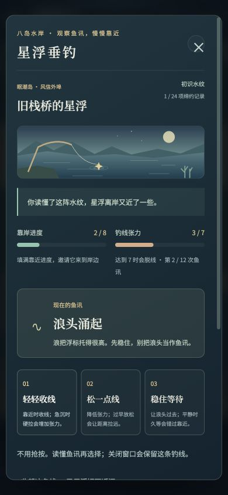

# 星潮纪行 · Starfall Chronicle

**把昨天交还给海，把明天留给自己。**

一款原创 2D 群岛探索与潮灵收集 RPG。带上伙伴，穿过八座被星潮改变的岛屿，修复记忆里的灯，在回合制对战中寻找一起走下去的办法。

**[▶ 免登录游玩](https://starfall-chronicle.seedagi.chatgpt.site)** · **[📖 完整攻略](docs/WALKTHROUGH.md)** · [运行方法](#本机运行) · [验证记录](docs/VALIDATION.md)


当前版本 **0.16.0**。桌面键鼠和手机触屏均可操作，进度自动保存在浏览器中。公开链接可直接开始，不需要注册账号。

## 游戏内容

| 玩法 | 当前内容 |
| --- | --- |
| 群岛主线 | 8 章剧情与结局、8 座城镇、24 个户外分区、32 层遗迹，共 64 张地图 |
| 地区冒险 | 24 条寻找记忆的任务路线、144 个阶段，包含交谈、调查、对战、交付和解谜 |
| 潮灵养成 | 20 个原创家族、60 种成长形态、9 种属性、38 个技能，六人队伍与备用驿站 |
| 策略对战 | 敌方行动预告、轮换、能量、天气、异常、家族特性、四招搭配与护符 |
| 人物故事 | 24 个居民委托、24 段居民故事、60 章伙伴同行纪事、营火谈话 |
| 探索与解谜 | 随身航图和真实寻路、24 组符柱封门、8 台旧日仪器与群岛回信 |
| 旅途生活 | 8 道料理、8 位厨师、4 个生态调查、8 处水岸与 24 项当地缔约记录 |
| 通关之后 | 8 段人物邀请、24 阶星海试航及共同尾声，随后可继续远海切磋 |
| 续玩体验 | 自动存档、上一份备份、导入导出、完整回合恢复、章节与已选回应回看 |

像素角色与场景由项目代码绘制，音乐与音效由浏览器合成。提供精细、均衡、流畅三档画质及实时 FPS 显示。

<details>
<summary>查看手机垂钓画面</summary>



</details>

## 本机运行

无需安装 npm 依赖，也不需要数据库。运行游戏只需要现代浏览器和 Python 3；修改与测试建议使用 Node.js 20 或更高版本。

### 下载代码

```bash
git clone https://github.com/Dhs2004/-_AI-.git starfall-chronicle
cd starfall-chronicle
```

也可以在 GitHub 点击 **Code → Download ZIP** 后解压。

### macOS 一键启动

双击仓库中的 **[启动游戏.command](启动游戏.command)**，或在项目目录运行：

```bash
python3 launch.py
```

启动器会打开浏览器。默认地址为 **http://127.0.0.1:4173**；若该端口被其他程序占用，会尝试 4174，请以终端输出为准。玩游戏期间保留终端，结束后按 `Ctrl+C` 关闭服务器。

### 通用启动

macOS / Linux：

```bash
python3 -m http.server 4173 --bind 127.0.0.1 --directory dist
```

Windows（已安装 Python 3）：

```powershell
py -m http.server 4173 --bind 127.0.0.1 --directory dist
```

然后打开 **http://127.0.0.1:4173**。已安装 npm 的环境也可以运行 `npm run dev`，它调用同一 Python 服务器。

请通过 HTTP 服务器访问，直接双击 `dist/index.html` 的 `file://` 打开方式可能阻止 ES Modules 加载。页面使用 Google Fonts，无法访问字体服务时使用系统字体回退；游戏逻辑与像素素材都在仓库内。

## 操作方式

| 操作 | 桌面 |
| --- | --- |
| 移动／奔跑 | WASD 或方向键／按住 Shift |
| 点击走路 | 点击地图地面，按实际道路寻路 |
| 互动 | E 或空格，与附近人物、路标、宝箱和机关互动 |
| 随身航图 | K，找附近目标与步行路线；到达后仍需互动 |
| 队伍／背包 | P／B |
| 群岛地图／手记／图鉴 | M／J／L |
| 战斗指令 | 点击按钮，或数字 1–4 选择当前菜单项 |
| 关闭菜单 | Esc |

手机使用屏幕方向键、互动按钮与底部菜单。战斗可切换 1× / 2× 演出；需要回顾效果时打开「招式说明」或「战况回顾」。

## 新手攻略：第一座岛怎么过

1. **选择伙伴。** 芽芽狐擅长恢复牵制，炭绒猫擅长灼伤爆发，泡泡鳍偏耐久控场。三种开局都可以继续培养。
2. **先看手记。** 在灯穗港按 J，查看「这座岛的三份记忆」。先找港口岸边的浮葵，开始「没有灯的引航课」。
3. **完成三条路线。** 浮葵的引航课、工坊附近结桥的水洼任务、镇中广场照豆的招牌任务，每条做完才给一份记忆。跟着阶段提示找人，居民委托不能代替这三份记忆。
4. **补充伙伴与药品。** 首岛可遇见芽芽狐、风铃雀、露珠团、卵石龟。先削弱野生潮灵，再用星约石；多种属性比只练一只更容易应对首领。诊所与营火可以免费恢复。
5. **进入归潮灯塔。** 三份记忆齐全后，去第三个户外分区的遗迹入口。前三层按石碑提示调整日／月／星符柱，第四层恢复后挑战岚婆。
6. **按阵容切换。** 岚婆使用苔角鹿 Lv.9 与卵石龟 Lv.10。焰攻适合前者，森或潮攻适合后者。看敌方意图，交替用低耗攻击、守势和强力招式。
7. **拿灯印再出海。** 完成战后剧情，按 M 打开群岛航图，前往镜湾岛。下岛继续「三份记忆 → 四层遗迹 → 守灯人」的主线结构。

### 八岛路线速查

| 章 | 岛屿／城镇 | 遗迹 | 首领初战等级 |
| --- | --- | --- | --- |
| 1 | 眠潮岛／灯穗港 | 归潮灯塔 | 9–10 |
| 2 | 镜湾岛／玻璃汀 | 镜湖档案馆 | 15–16 |
| 3 | 赤炉岛／炭火集 | 无声熔炉 | 21–23 |
| 4 | 悬钟岛／风栖驿 | 停摆钟庭 | 27–29 |
| 5 | 白眠岛／雪棉镇 | 长夜观测所 | 33–35 |
| 6 | 苔梦岛／青苔里 | 树心剧场 | 39–41 |
| 7 | 曜都岛／曦光城 | 永昼议事厅 | 45–48 |
| 8 | 归零岛／最后驿站 | 群星之井 | 52–56 |

后续详细路线见 **[完整攻略](docs/WALKTHROUGH.md)**，包含：

- 八章任务发起人、第一站、阶段顺序、首领阵容与应对。
- 属性克制表、技能开放等级、六人队建议、捕获与长战技巧。
- 八道料理配方、四个生态调查、八岛垂钓位置和纪念护符条件。
- 折叠的 20 个主线顺序谜题、24 组符柱、8 台仪器解法。
- 通关后试航、两天游玩安排、卡关排查与存档搬迁。

**小提醒：** 技能在 12 / 22 / 38 级开放进阶选项，要到「技能记忆」主动装入；捕获辅助「留星一触」会留 1 HP，但后续中毒与灼伤仍可能击倒目标。

## 存档与换设备

游戏使用浏览器本地存档，不会把进度上传到 GitHub。设置中可导出 JSON 备份、导入存档或恢复上一份备份。建议每天结束游玩时手动导出一次。

官网、`localhost`、`127.0.0.1`、不同端口及不同浏览器各自保存。换入口或设备时，先在原地址导出，再到新地址导入。不要把自己的存档当成代码提交到公开仓库。

## 开发与验证

原生 JavaScript ES Modules + HTML/CSS + Canvas 2D + Web Audio，无打包构建步骤。`dist/` 同时是可阅读源码与静态站点根目录。

```bash
npm run check
npm test
```

当前游戏版本 **143 项自动测试通过**，覆盖战斗、存档、地图可达性、剧情奖励、料理、垂钓及渲染缓存。手机尺寸和真实浏览器操作也经过检查。详细条件、报告及性能测量边界见 [验证记录](docs/VALIDATION.md)。

| 路径 | 内容 |
| --- | --- |
| `dist/index.html`、`dist/style.css` | 页面入口与布局 |
| `dist/js/game.js`、`engine.js` | 界面交互、战斗结算和存档 |
| `dist/js/data.js`、`stories.js`、`expedition-stories.js` | 伙伴、技能、主线和任务数据 |
| `dist/js/world.js`、`dungeons.js`、`outdoor-areas.js` | 地图与遗迹 |
| `dist/js/art.js`、`outdoor-art.js`、`battle-backdrops.js` | 原创绘制素材 |
| `tests/`、`qa/`、`scripts/` | 自动测试、独立测试页面与研究脚本 |
| `docs/WALKTHROUGH.md` | 完整攻略与谜题答案 |
| `DEVELOPMENT.md` | 逐版本开发与发布记录 |

部署到静态托管时，以 **`dist/`** 为发布目录；根目录 README 是仓库介绍，游戏入口在 `dist/index.html`。现有公开游戏地址位于上方「免登录游玩」链接。

## 当前范围

本作已可游玩，主线与试航都有结尾。目标是支持分两天累计 16–24 小时的探索体验，但**尚未完成真人全流程时长验证**；攻略中的两天安排是建议，游戏没有强制等待时间，也不宣称达到商业长篇 RPG 的体量。

本机 Chrome 的一次短时渲染测试为 114–121 FPS；它不能代表所有设备或整段游玩持续帧率。具体条件见验证记录。
